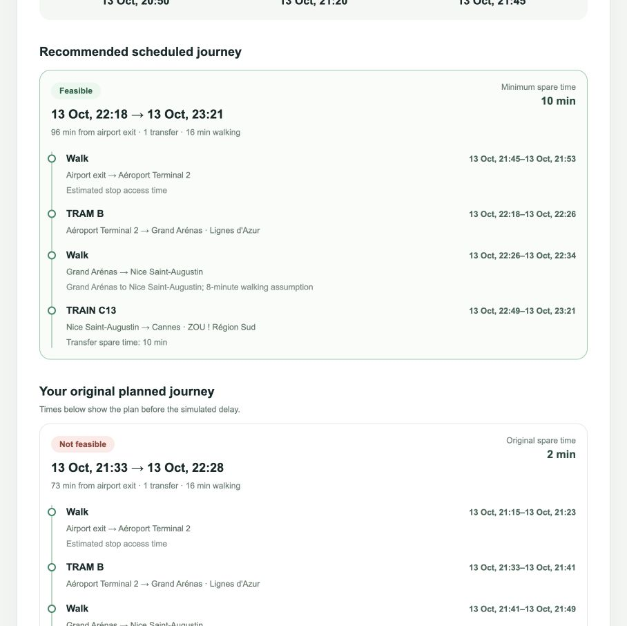

# LastLink

**Know whether your onward journey is still possible after a flight delay.**

LastLink is a local web app for passengers arriving at **Nice Côte d’Azur Airport Terminal 2**. Enter a scheduled landing time and a simulated delay; LastLink checks official **scheduled** public transport and builds complete journeys to Nice city centre, Antibes, or Cannes. It shows the original plan, a recommended alternative, transfer time, and the last complete connection.

> **Planning tool, not live tracking.** Flight arrivals and delays are entered by the passenger. Transport times come from downloaded GTFS schedules. LastLink does not know whether a vehicle is running, whether seats are available, or whether a connection is guaranteed.



## What it supports

| Destination | Scheduled options checked |
| --- | --- |
| Nice city centre · Jean Médecin | Direct Lignes d’Azur tram |
| Antibes · railway station | Tram to Grand Arénas, walk to Nice Saint-Augustin, then ZOU regional train |
| Cannes · railway station | ZOU airport bus 81, or tram, walk, and regional train |

The router reads actual trips and service calendars from [Lignes d’Azur](https://transport.data.gouv.fr/datasets/donnees-statiques-et-dynamiques-du-reseau-de-transport-lignes-dazur) and [ZOU Express](https://transport.data.gouv.fr/datasets/lignes-des-reseaux-transport-zou-provence-alpes-cote-d-azur-express-3-3). It does not invent departures. The Grand Arénas–Nice Saint-Augustin pedestrian link is enabled only when the two feeds contain plausible stop coordinates; its **eight-minute duration is a planning assumption**, not a measured walking time. See [data-source verification](docs/data-sources.md).

## Run with Docker

Docker Compose is the quickest route. You need Docker and an internet connection for the first two public GTFS downloads. No account, API key, or paid service is required.

```bash
git clone https://github.com/pradeepjoel/LastLink.git
cd LastLink
docker compose up --build -d
```

Open **[LastLink](http://localhost:3000)**. The [API documentation](http://localhost:8000/docs) is available separately. On first start, the API downloads and validates both archives before it begins serving requests; this can take a little while. To check startup:

```bash
docker compose logs -f api
```

The imported SQLite databases live in the ignored `data/` directory. Refresh both scheduled feeds manually when needed:

```bash
docker compose exec api python -m app.import_gtfs
```

Stop the app with `docker compose down`. The local GTFS databases remain in `data/` for the next run.

## Run without Docker

Use Python 3.11+, Node.js 22+, npm, and an internet connection. From the repository root:

```bash
python3.11 -m venv .venv
source .venv/bin/activate
pip install -r backend/requirements.txt
PYTHONPATH=backend python -m app.import_gtfs
PYTHONPATH=backend uvicorn app.main:app --reload
```

In a second terminal:

```bash
cd frontend
npm ci
npm run dev
```

The frontend uses `http://localhost:8000` by default. For a different API address, copy `frontend/.env.example` to `frontend/.env.local` and edit it before starting Next.js. Backend database paths can be overridden with `LASTLINK_DB` and `LASTLINK_REGIONAL_DB`; their defaults are under the repository’s `data/` directory. The backend does not automatically load a root `.env` file.

## Reading a result

- **Original plan:** the earliest complete journey available without the simulated flight delay, then classified against the delayed arrival.
- **Recommended journey:** a complete route from airport exit to the selected destination. Feasible options rank ahead of at-risk options; arrival time, transfers, and walking help break ties.
- **Last complete connection:** the latest first departure that still reaches the destination under the stated assumptions. It is not merely the last vehicle leaving the airport.
- **Status:** `FEASIBLE` means the displayed exit and buffers allow the journey; `AT_RISK` means exit uncertainty or a tight transfer threatens it; `NOT_FEASIBLE` means the original plan is missed or no complete path remains; `UNKNOWN` means required schedule data is stale or outside its validity.

The default estimates are 25 minutes from landing to airport exit, plus 15 minutes for checked baggage if selected; 10 minutes of exit uncertainty; 8 minutes to reach the first stop; and 5-minute boarding and transfer buffers. Passengers can edit these values. They are **not measured airport performance**. The inter-stop Grand Arénas walk is displayed as a separate eight-minute assumption.

## Project layout

```text
backend/app/       FastAPI, GTFS import, timetable graph, journey assessment
backend/tests/     Deterministic fixtures and optional official-feed validation
frontend/app/      Next.js passenger interface and styling
docs/              API, architecture, source research, roadmap, screenshot
.github/workflows/ Backend/frontend checks and dependency audits
data/              Local GTFS SQLite snapshots (generated; ignored by Git)
docker-compose.yml Local two-service deployment
```

Technical details: [architecture](docs/architecture.md) · [API contract](docs/api.md) · [source research and licences](docs/data-sources.md) · [roadmap](docs/roadmap.md) · [contributing](CONTRIBUTING.md).

## Tests

Activate the Python virtual environment from the local setup first, or use its `python` executable explicitly.

```bash
PYTHONPATH=backend python -m pytest -q backend/tests
npm ci --prefix frontend
npm run build --prefix frontend
```

The regular backend suite uses synthetic GTFS fixtures and does not call external transport APIs. To validate two already downloaded official ZIP archives as a separate integration check:

```bash
LASTLINK_REAL_GTFS=/path/to/lignes-dazur.zip \
LASTLINK_REGIONAL_GTFS=/path/to/zou-express.zip \
PYTHONPATH=backend python -m pytest -q backend/tests/test_real_feed.py
```

## Scope and limitations

- Search covers verified corridors from Terminal 2 and ends at the next 04:00 Europe/Paris service boundary; it is not a citywide route planner.
- Scheduled GTFS cannot confirm disruptions, platform changes, accessibility, fares, or seat availability. Check the current service with the operator before travel.
- An itinerary using an archive older than seven days, or outside that feed’s service dates, is marked `UNKNOWN` rather than presented confidently.
- Realtime transport and flight data, alerts, and AI explanations are future work. Routing remains deterministic and independent of AI.

Transport data © Métropole Nice Côte d’Azur / Lignes d’Azur and ZOU ! Région Sud, [Licence Ouverte 2.0](https://www.etalab.gouv.fr/wp-content/uploads/2017/04/ETALAB-Licence-Ouverte-v2.0.pdf). LastLink is independent and is not affiliated with the operators or airport. The application code is released under the [MIT License](LICENSE).
